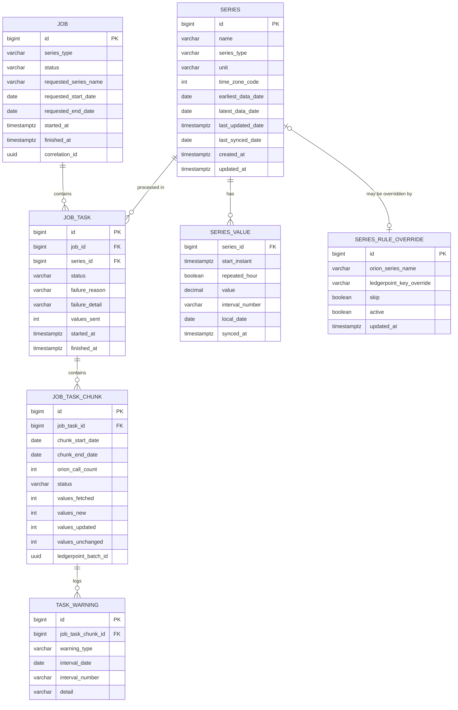

# Data Sync Service — Database Design

Version: 1.0
Companion to: `architecture.md` (see ADR on TimescaleDB scoping, §9/§10), `Data_Sync_POC_Specification.md` §9

---

## 1. Engine & Migration Tooling

- **Engine:** PostgreSQL with the TimescaleDB extension enabled (see `architecture.md` §9 "Scope
  For The POC"). Every table is a normal Postgres table except `series_value`, which is a
  TimescaleDB hypertable.
- **Migrations:** Flyway, versioned SQL files (`V1__init_schema.sql`, `V2__...`). Chosen over
  Liquibase for simpler default Spring Boot integration and because raw SQL is the most direct way
  to express the hypertable/partial-index DDL below.
- **Test database:** Testcontainers `timescale/timescaledb:latest-pg16` — same image shape as
  production, so hypertable behavior is exercised in integration tests, not just unit tests against
  H2 (H2 cannot host the TimescaleDB extension).

---

## 2. Entity-Relationship Diagram



---

## 3. Table Definitions

### 3.1 `job`

One row per sync execution (spec §3, §7.1).

| Column | Type | Constraints | Notes |
|---|---|---|---|
| `id` | `bigint` | PK, identity | |
| `series_type` | `varchar(20)` | not null | `typeA` \| `typeB` |
| `status` | `varchar(30)` | not null | `RUNNING` \| `COMPLETED` \| `COMPLETED_WITH_FAILURES` \| `FAILED` |
| `requested_series_name` | `varchar(100)` | nullable | set when caller targets a single series |
| `requested_start_date` | `date` | nullable | caller override of computed window |
| `requested_end_date` | `date` | nullable | caller override of computed window |
| `started_at` | `timestamptz` | not null | |
| `finished_at` | `timestamptz` | nullable | null while `RUNNING` |
| `correlation_id` | `uuid` | not null | propagated to Orion/LedgerPoint calls and logs (spec §8) |

**Indexes / constraints:**
- `CREATE UNIQUE INDEX uq_job_running_per_type ON job (series_type) WHERE status = 'RUNNING';`
  — enforces "one running job per series type" (spec §7.1 409 response; see `architecture.md`
  "Concurrency & Job Locking").
- `CREATE INDEX ix_job_series_type_started_at ON job (series_type, started_at DESC);` — supports
  listing/history queries.

### 3.2 `job_task`

One row per series within a job (spec §7.2).

| Column | Type | Constraints | Notes |
|---|---|---|---|
| `id` | `bigint` | PK, identity | |
| `job_id` | `bigint` | FK → `job.id`, not null | |
| `series_id` | `bigint` | FK → `series.id`, not null | |
| `status` | `varchar(30)` | not null | `PENDING` \| `SUCCESS` \| `SUCCESS_WITH_WARNINGS` \| `SKIPPED` \| `FAILED` |
| `failure_reason` | `varchar(50)` | nullable | one of the §8.1 codes: `SOURCE_UNAVAILABLE`, `NO_DATA`, `STALE_SERIES`, `UNSUPPORTED_GRANULARITY`, `UNSUPPORTED_TIMEZONE`, `TARGET_REJECTED`, `UNKNOWN_SERIES`, `TARGET_UNAVAILABLE`, `INTERNAL_ERROR` |
| `failure_detail` | `varchar(2000)` | nullable | e.g. LedgerPoint 400 error body |
| `values_sent` | `int` | not null, default 0 | |
| `started_at` | `timestamptz` | nullable | |
| `finished_at` | `timestamptz` | nullable | |

**Indexes:**
- `CREATE INDEX ix_job_task_job_id ON job_task (job_id);`
- `CREATE INDEX ix_job_task_series_status ON job_task (series_id, status);`

### 3.3 `job_task_chunk` (new)

One row per calendar-month chunk processed within a Task (spec §3.1 step 2). Gives a queryable
answer to "how many Orion calls did this series make" and a mid-job resume point.

| Column | Type | Constraints | Notes |
|---|---|---|---|
| `id` | `bigint` | PK, identity | |
| `job_task_id` | `bigint` | FK → `job_task.id`, not null | |
| `chunk_start_date` | `date` | not null | first day of the month chunk |
| `chunk_end_date` | `date` | not null | last day of the month chunk |
| `orion_call_count` | `int` | not null, default 0 | normally 1; >1 when a retry or a 401 token refresh re-issued the HTTP call. Written once the fetch returns; a chunk whose fetch ultimately fails keeps the initial 1 |
| `status` | `varchar(30)` | not null | lifecycle `PENDING` (created) → `FETCHED` → `TRANSFORMED` → `PUBLISHED` → `PERSISTED`; `FAILED` on any error. A chunk with nothing to send skips `PUBLISHED`; an empty month goes straight to `PERSISTED`. |
| `values_fetched` | `int` | not null, default 0 | |
| `values_new` | `int` | not null, default 0 | |
| `values_updated` | `int` | not null, default 0 | |
| `values_unchanged` | `int` | not null, default 0 | |
| `ledgerpoint_batch_id` | `uuid` | nullable | from LedgerPoint's `200` response (§5.1) |

**Indexes / constraints:**
- `CREATE UNIQUE INDEX uq_chunk_task_start ON job_task_chunk (job_task_id, chunk_start_date);`

### 3.4 `task_warning`

Non-fatal issues recorded against a chunk (gap-filling, DST) — keeps a Task's `SUCCESS_WITH_WARNINGS`
status (spec §6.8) explainable.

| Column | Type | Constraints | Notes |
|---|---|---|---|
| `id` | `bigint` | PK, identity | |
| `job_task_chunk_id` | `bigint` | FK → `job_task_chunk.id`, not null | |
| `warning_type` | `varchar(50)` | not null | `GAP_MISSING` \| `DST_SPRING_FORWARD_FILLED` \| `DST_FALL_BACK_REPEATED` |
| `interval_date` | `date` | nullable | local date the warning applies to |
| `interval_number` | `varchar(5)` | nullable | e.g. `"3"` or `"2x"` |
| `detail` | `varchar(500)` | nullable | human-readable note |

**Index:** `CREATE INDEX ix_task_warning_chunk ON task_warning (job_task_chunk_id);`

### 3.5 `series`

Master/reference row per Orion series, refreshed from the list call (§4.2) and the values call
(§4.3).

| Column | Type | Constraints | Notes |
|---|---|---|---|
| `id` | `bigint` | PK, identity | |
| `name` | `varchar(100)` | unique, not null | Orion `seriesName` |
| `series_type` | `varchar(20)` | not null | `typeA` \| `typeB` |
| `unit` | `varchar(20)` | nullable | last-observed Orion `unit` (from values call; refreshed per fetch) |
| `time_zone_code` | `int` | not null | Orion `timeZone` int (§6.2) |
| `earliest_data_date` | `date` | nullable | from Orion list call |
| `latest_data_date` | `date` | nullable | from Orion list call |
| `last_updated_date` | `timestamptz` | nullable | Orion `lastUpdatedDate`; source for staleness check (§6.9) |
| `last_synced_date` | `date` | nullable | service's own high-watermark; null ⇒ never synced ⇒ window defaults to "1 year prior" (§3.1) |
| `created_at` | `timestamptz` | not null, default now | |
| `updated_at` | `timestamptz` | not null, default now | |

**Index:** unique on `name` (doubles as lookup index).

### 3.6 `series_rule_override`

Naming/skip overrides (spec §6.6).

| Column | Type | Constraints | Notes |
|---|---|---|---|
| `id` | `bigint` | PK, identity | |
| `orion_series_name` | `varchar(100)` | unique, not null | |
| `ledgerpoint_key_override` | `varchar(100)` | nullable | if null, LedgerPoint `key` = `orion_series_name` |
| `skip` | `boolean` | not null, default false | if true, Task finishes `SKIPPED` |
| `active` | `boolean` | not null, default true | allows disabling an override without deleting it (audit trail) |
| `updated_at` | `timestamptz` | not null, default now | |

### 3.7 `series_value` — TimescaleDB hypertable

The diffing/audit source of truth. Primary key matches the spec's exact change-detection key
(§6.7): `(series, startInstant, repeatedHour)`.

| Column | Type | Constraints | Notes |
|---|---|---|---|
| `series_id` | `bigint` | FK → `series.id`, not null | |
| `start_instant` | `timestamptz` | not null | UTC instant (converted from Orion prevailing time + `time_zone_code`) |
| `repeated_hour` | `boolean` | not null, default false | true only for the fall-back repeated hour |
| `value` | `decimal(19,6)` | not null | matches spec's "up to 6 decimal places" |
| `interval_number` | `varchar(5)` | not null | pre-computed LedgerPoint interval token, e.g. `"24"`, `"2x"` — avoids recompute on replay/audit |
| `local_date` | `date` | not null | local day derived from `start_instant` + timezone; matches LedgerPoint's `date` field directly |
| `synced_at` | `timestamptz` | not null, default now | when this row was last confirmed sent to LedgerPoint |

**Primary key:** `(series_id, start_instant, repeated_hour)`

**Hypertable setup:**
```text
SELECT create_hypertable('series_value', 'start_instant', chunk_time_interval => INTERVAL '1 month');
```

**Indexes:**
- `CREATE INDEX ix_series_value_series_localdate ON series_value (series_id, local_date);` —
  supports day-level LedgerPoint-shaped queries and re-publish/replay.

No compression policy is configured for the POC (see `architecture.md` §9 "Scope For The POC").

---

## 4. Enumerations (application-level, stored as `varchar`)

| Enum | Values |
|---|---|
| `job.status` | `RUNNING`, `COMPLETED`, `COMPLETED_WITH_FAILURES`, `FAILED` |
| `job_task.status` | `PENDING`, `SUCCESS`, `SUCCESS_WITH_WARNINGS`, `SKIPPED`, `FAILED` |
| `job_task.failure_reason` | `SOURCE_UNAVAILABLE`, `NO_DATA`, `STALE_SERIES`, `UNSUPPORTED_GRANULARITY`, `UNSUPPORTED_TIMEZONE`, `TARGET_REJECTED`, `UNKNOWN_SERIES`, `TARGET_UNAVAILABLE`, `INTERNAL_ERROR` |
| `job_task_chunk.status` | `PENDING`, `FETCHED`, `TRANSFORMED`, `PUBLISHED`, `PERSISTED`, `FAILED` |
| `task_warning.warning_type` | `GAP_MISSING`, `DST_SPRING_FORWARD_FILLED`, `DST_FALL_BACK_REPEATED` |

`varchar` (not native Postgres `enum`) is used deliberately so new values (e.g. a future failure
reason) only require an application-side change, not a migration that alters a type.

---

## 5. Traceability: Spec §11 Acceptance Criteria → Schema

| # | Criterion | Schema support |
|---|---|---|
| 1 | Sync every series, correct `taskCounts` | `job_task.status` grouped by `job_id` reproduces `taskCounts` exactly |
| 2 | 3-month window → exactly 3 Orion calls | `job_task_chunk` rows (one per month) with `orion_call_count`, queryable per `job_task_id` |
| 3 | Fall-back day → 25 rows incl. one `Nx` | `series_value.interval_number` stores the literal token (e.g. `2x`); `repeated_hour=true` row coexists with `repeated_hour=false` row at the same `interval_number` prefix |
| 4 | Spring-forward → 24 rows, filled, no `x` | filled row persisted like any other `series_value` row; no `task_warning` is recorded for the fill (it is silent, spec §6.4/§6.8) |
| 5 | 15-min → `1..96`; daily → `1` | `interval_number` computed per §6.3 and stored verbatim; no schema constraint needed since computation is domain logic |
| 6 | Re-run sends 0 values | diff compares incoming values against existing `series_value` PK `(series_id, start_instant, repeated_hour)`; all match ⇒ `values_unchanged` in `job_task_chunk`, nothing posted |
| 7 | Change one value → sends exactly 1 | same PK lookup finds one row where `value` differs ⇒ classified `values_updated=1` |
| 8 | Orion 429 → retry succeeds | not a schema concern; `job_task_chunk.orion_call_count` shows >1 when a retry re-issued the call |
| 9 | Orion 401 mid-run → refresh, continue | not a schema concern (token cache is in-memory in the adapter) |
| 10 | LedgerPoint 400 on one series → only that Task fails | `job_task.status='FAILED'`, `failure_reason='TARGET_REJECTED'`, `failure_detail` stores the error body; sibling `job_task` rows unaffected |
| 11 | Stale series → `FAILED`/`STALE_SERIES`, nothing posted | `series.last_updated_date` checked before any `job_task_chunk` is created; `job_task.failure_reason='STALE_SERIES'` |
| 12 | Plain decimal strings, no scientific notation | `series_value.value` is `decimal(19,6)`; serialization to LedgerPoint payload is an application-layer concern, not stored as text |
| 13 | No credentials in logs/repo | no credential columns exist anywhere in this schema; tokens/API keys are never persisted |

---

## 6. Deliberate Deviations From The Spec's Minimal Schema (§9)

- Added `job_task_chunk` and formalized `task_warning` as its child (spec's own suggested schema in
  §9 only lists `job`, `job_task`, `series`, `series_value` — `task_warning` and chunk-level detail
  were architecture.md recommendations, now fully specified here).
- Did not add a separate `sync_checkpoint` table (`architecture.md` originally suggested one) —
  `series.last_synced_date` already serves as the high-watermark the spec describes in §3.1, and a
  second table would duplicate it.
- Did not add `job_execution_log` — structured logging (already mandated by spec §8) covers the same
  need without a write-heavy table.
